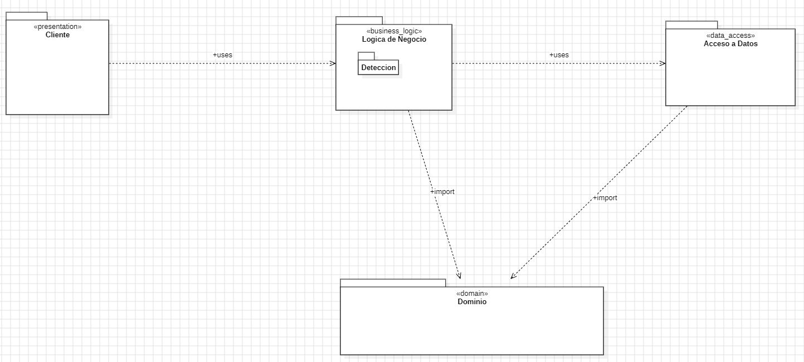
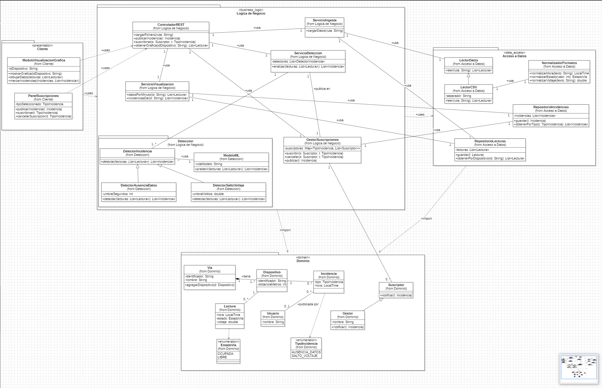
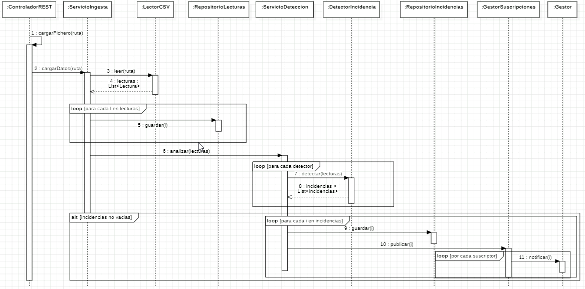

# Práctica 1: Captura de Requisitos Software y Diseño UML

**Ingeniería del Software · Grado en Inteligencia Artificial · Universidad Rey Juan Carlos**
**Curso 2026-2027 · Grupo IS-P1-G1**

---

## Sobre el proyecto

Este repositorio recoge el análisis de requisitos y el diseño UML de una aplicación web para la **monitorización y detección predictiva de incidencias en infraestructuras ferroviarias**.

El sistema procesa señales de voltaje y datos de ocupación almacenados en un archivo CSV. A partir de las lecturas detecta:

- Ausencias de datos superiores a dos minutos.
- Saltos de voltaje de al menos 0,5 V.
- Incidencias visualizadas gráficamente y notificadas a los gestores suscritos.

La comunicación entre cliente y servidor se basa en HTTP/REST, con una arquitectura organizada en tres capas y una capa transversal de dominio.

---

## Vista general del diseño

[Ver diagrama de paquetes](docs/02-diseño/diagrama-paquetes.md)

---

## Contenido del repositorio

### 01 — Requisitos

| Documento | Contenido |
|---|---|
| [Captura de requisitos](docs/01-requisitos/requisitos.md) | Requisitos funcionales RF y requisitos de dominio o tecnológicos RD |

### 02 — Diseño

| Documento | Contenido |
|---|---|
| [Diagrama de paquetes](docs/02-diseño/diagrama-paquetes.md) | Arquitectura del sistema y dependencias entre paquetes |
| [Diagrama de clases y paquetes](docs/02-diseño/diagrama-clases-paquetes.md) | Modelo estructural completo y relaciones entre clases |
| [Diagrama de secuencias](docs/02-diseño/diagrama-secuencias.md) | Flujo de carga, detección y notificación |
| [Estilos arquitectónicos](docs/02-diseño/estilos.md) | Estilos y decisiones arquitectónicas aplicadas |
| [Patrones de diseño](docs/02-diseño/patrones.md) | Adapter, Strategy y Observer |

### Diagramas por paquete

| Paquete | Diagrama |
|---|---|
| Cliente | [Clases](docs/02-diseño/clases-detalle/cliente.md) · [Imagen](docs/02-diseño/img/clases-cliente.png) |
| Lógica de Negocio | [Clases](docs/02-diseño/clases-detalle/logica-negocio.md) · [Imagen](docs/02-diseño/img/clases-logica-negocio.png) |
| Acceso a Datos | [Clases](docs/02-diseño/clases-detalle/acceso-datos.md) · [Imagen](docs/02-diseño/img/clases-acceso-datos.png) |
| Dominio | [Clases](docs/02-diseño/clases-detalle/dominio.md) · [Imagen](docs/02-diseño/img/clases-dominio.png) |
| Detección | [Clases](docs/02-diseño/clases-detalle/deteccion.md) · [Imagen](docs/02-diseño/img/clases-deteccion.png) |

---

## Arquitectura y diseño aplicado

### Patrones

- **Adapter:** permite leer datos CSV a través de la abstracción `LectorDatos`.
- **Strategy:** permite incorporar diferentes detectores de incidencias.
- **Observer:** notifica automáticamente las incidencias a los gestores suscritos.

### Técnicas de modelado

- Arquitectura Cliente/Servidor en tres capas.
- Paquete transversal `Dominio`.
- Dependencias acíclicas entre paquetes.
- Separación de responsabilidades.
- Aplicación de patrones en los diagramas estructurales y dinámicos.

---

## Diagramas principales

| Diagrama | Vista |
|---|---|
| [Clases y paquetes](docs/02-diseño/diagrama-clases-paquetes.md) |  |
| [Secuencias](docs/02-diseño/diagrama-secuencias.md) |  |

---

## Equipo

| Miembro | Rol | Responsabilidad principal |
| :--- | :--- | :--- |
| **Enrique BETANCOURT PUIG** | Analista Software | Captura y trazabilidad de requisitos |
| **David GRACIANI ROBLES** | Analista Software | Captura y trazabilidad de requisitos |
| **Francisco CASERO SANCHEZ** | Arquitecto Software | Diagramas estructurales, estilos y patrones |
| **Alejandro PEÑA PAZ** | Arquitecto Software | Diagrama de secuencias y modelado dinámico |
