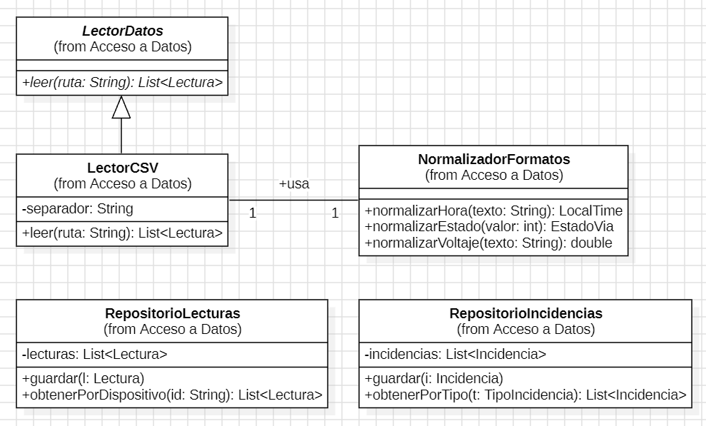

## Diagrama de Clases: Paquete `Acceso a Datos`

El paquete **`Acceso a Datos`** aísla por completo la lectura física de los ficheros de entrada, el parseo de formatos y la persistencia en memoria. Importa (`+import`) las entidades del paquete `Dominio` para instanciar y gestionar objetos `Lectura` e `Incidencia`, sin depender nunca de la `Logica de Negocio`.

### Elementos del modelo

* **`LectorDatos` y `LectorCSV` (RF1, RD3)**: Implementan el patrón **Adapter** para desacoplar el origen físico de los datos. `LectorDatos` es una clase abstracta que expone la operación `+leer(ruta: String): List<Lectura>`, mientras que `LectorCSV` la implementa específicamente para procesar ficheros CSV (**RF1.1**), permitiendo incorporar nuevas fuentes en el futuro sin alterar el resto del sistema.
* **`NormalizadorFormatos` (RF1.2, RD4–RD6)**: Clase auxiliar asociada (`1` a `1`) a `LectorCSV` encargada de transformar los campos crudos del fichero a los tipos fuertes del dominio: hora (`LocalTime` en formato `HH:MM:SS:MS`), estado (`EstadoVia`: `OCUPADA` / `LIBRE`) y voltaje (`double`).
* **`RepositorioLecturas` y `RepositorioIncidencias`**: Componentes de persistencia y consulta que almacenan las colecciones de lecturas e incidencias del sistema, ofreciendo métodos de filtrado por identificador de dispositivo o por `TipoIncidencia`. Aparecen desacoplados internamente en este diagrama porque son invocados directamente desde los servicios de la `Logica de Negocio`.