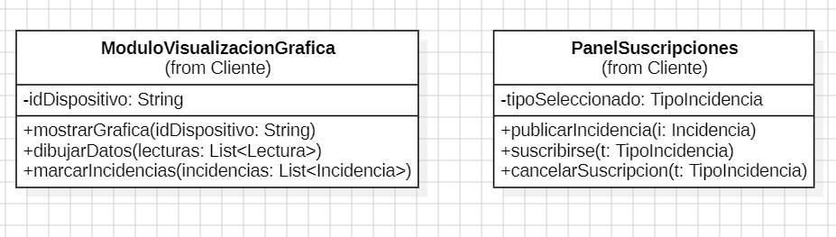

## Diagrama de Clases: Paquete `Cliente`

El paquete **`Cliente`** representa la capa de presentación ejecutada en el navegador web del gestor. Se comunica exclusivamente con la `Logica de Negocio` mediante llamadas **HTTP/REST** (**RD1, RD2**), manteniendo un aislamiento total respecto a la capa de acceso a datos.

### Elementos del modelo

* **`ModuloVisualizacionGrafica` (RF5)**: Componente encargado de renderizar las gráficas del dispositivo identificado en `-idDispositivo: String`. Solicita la serie temporal al servidor (`+mostrarGrafica`), representa la evolución por minuto (**RF5.1**), el estado de ocupación `0/1` (**RF5.2**) y el voltaje (**RF5.3**) mediante `+dibujarDatos`, y destaca visualmente las anomalías detectadas con `+marcarIncidencias` (**RF5.4**).
* **`PanelSuscripciones` (RF4.1, RF4.2)**: Interfaz de interacción desde la cual se reportan incidencias manualmente (`+publicarIncidencia`) y los gestores administran sus alertas (`+suscribirse` y `+cancelarSuscripcion`) sobre la categoría almacenada en `-tipoSeleccionado: TipoIncidencia`. Las acciones de este panel y del módulo gráfico se corresponden directamente con los endpoints expuestos por `ControladorREST`.