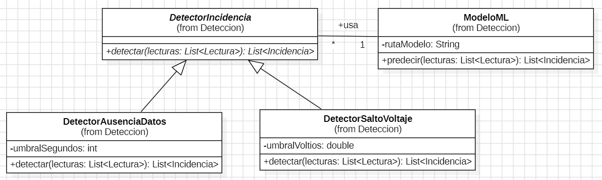

## Diagrama de Clases: Subpaquete `Deteccion`

El subpaquete **`Deteccion`**, encapsulado dentro de la `Logica de Negocio`, centraliza la identificación automática de anomalías (**RF3**) aplicando el **patrón Strategy**. Gracias a esta arquitectura, incorporar nuevos criterios de detección en el futuro solo requiere crear una nueva subclase sin modificar el código existente.

### Elementos del modelo

* **`DetectorIncidencia`**: Clase abstracta que define la interfaz común mediante la operación `+detectar(lecturas: List<Lectura>): List<Incidencia>`. Es la única abstracción que conoce el resto de la lógica de negocio.
* **`DetectorAusenciaDatos` (RF3.1)**: Estrategia concreta que detecta cortes de transmisión superiores a 2 minutos (`120` segundos), parametrizados en el atributo `-umbralSegundos: int`.
* **`DetectorSaltoVoltaje` (RF3.2)**: Estrategia concreta que identifica variaciones de tensión de al menos `0,5 V` entre dos lecturas consecutivas, configuradas en `-umbralVoltios: double`.
* **`ModeloML` (RD8)**: Módulo de Machine Learning encargado de clasificar y predecir anomalías a partir de las lecturas (`+predecir(...)`). La asociación `+usa` (`*` a `1`) indica que cada detector opera con un único modelo, pudiendo ser compartido por varios detectores.