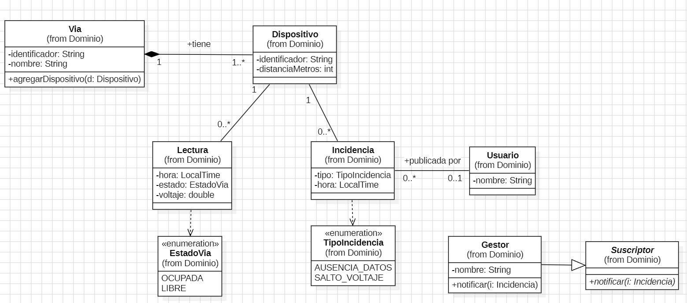

## Diagrama de Clases: Paquete `Dominio`

El paquete **`Dominio`** constituye la capa base transversal del sistema. Contiene las entidades fundamentales del problema y **no depende de ningún otro paquete**, permitiendo que tanto la `Logica de Negocio` como el `Acceso a Datos` compartan el mismo modelo sin acoplarse entre sí.

### Elementos del modelo

* **`Via` y `Dispositivo` (RF2, RD7)**: Relación de **composición** (`1` a `1..*`), ya que un dispositivo no tiene entidad fuera de su vía. Cada `Dispositivo` cuenta con un identificador único y su distancia de separación (`200` o `500` metros).
* **`Lectura` (RF1.1)**: Representa cada registro individual de un dispositivo (`0..*`), almacenando la hora (`LocalTime`), el estado de ocupación (`EstadoVia`) y el voltaje (`double`).
* **`Incidencia` (RF3)**: Modela una anomalía asociada a un dispositivo (`0..*`) con su tipo (`TipoIncidencia`) y marca temporal. Mantiene una asociación `0..1` con `Usuario`, ya que puede ser reportada manualmente (**RF4.1**) o detectada automáticamente por el sistema.
* **`EstadoVia` y `TipoIncidencia` (`<<enumeration>>`)**: Tipos enumerados cerrados. `EstadoVia` diferencia entre `OCUPADA` y `LIBRE` (**RD5**), mientras que `TipoIncidencia` acota las anomalías a `AUSENCIA_DATOS` (**RF3.1**) y `SALTO_VOLTAJE` (**RF3.2**).
* **`Usuario`**: Actor que puede generar y publicar incidencias de forma manual (**RF4.1**).
* **`Gestor` y `Suscriptor` (RF4.2)**: Implementan el lado observador del patrón **Observer**. `Suscriptor` define la clase abstracta con la operación `+notificar(i: Incidencia)` y `Gestor` hereda de ella para recibir los avisos de las incidencias a las que esté suscrito.