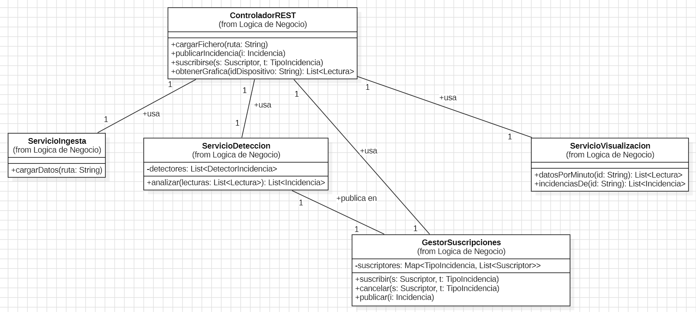

## Diagrama de Clases: Paquete `Logica de Negocio`

El paquete **`Logica de Negocio`** actúa como el servidor central del sistema, orquestando el flujo de ejecución y coordinando las clases de `Acceso a Datos`, `Dominio` y el subpaquete `Deteccion`. Su diseño mantiene una alta cohesión donde el controlador delega en servicios especializados desacoplados entre sí.

### Elementos del modelo

* **`ControladorREST` (RD2)**: Punto de entrada de la API del servidor. Recibe las peticiones HTTP de la capa cliente y las delega al servicio correspondiente mediante cuatro operaciones principales: `+cargarFichero` (**RF1**), `+publicarIncidencia` (**RF4.1**), `+suscribirse` (**RF4.2**) y `+obtenerGrafica` (**RF5**).
* **`ServicioIngesta` (RF1)**: Gestiona la carga inicial de datos invocando al lector de `Acceso a Datos` (`+cargarDatos`) y persistiendo las lecturas resultantes en su repositorio.
* **`ServicioDeteccion` (RF3)**: Evalúa las lecturas recibidas aplicando las estrategias configuradas en `-detectores: List<DetectorIncidencia>` (patrón **Strategy**). Cuando identifica una anomalía, la remite directamente a `GestorSuscripciones` (`+publica en`).
* **`ServicioVisualizacion` (RF5)**: Prepara las series de datos para la interfaz gráfica, recuperando las lecturas de un dispositivo agregadas por minuto (`+datosPorMinuto`, **RF5.1**) junto con sus incidencias asociadas (`+incidenciasDe`, **RF5.4**).
* **`GestorSuscripciones` (RF4)**: Implementa el sujeto del patrón **Observer**. Mantiene el registro de suscriptores por categoría en `-suscriptores`, permitiendo añadir (`+suscribir`), eliminar (`+cancelar`) y notificar automáticamente (`+publicar`) cada incidencia a los gestores interesados.