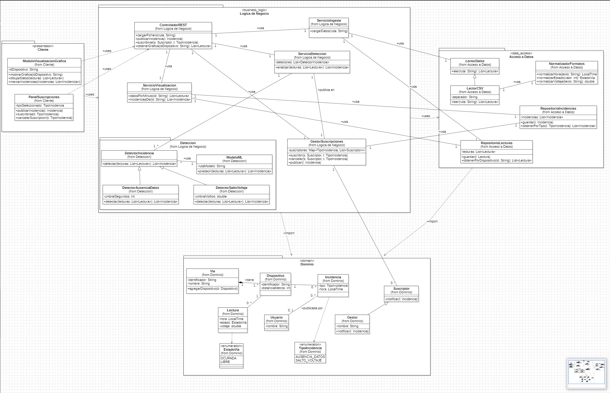

## Diagrama de Clases y Paquetes

Este diagrama integra la vista estructural completa del sistema, mostrando las clases organizadas dentro de los cuatro paquetes principales (`Cliente`, `Logica de Negocio`, `Acceso a Datos` y `Dominio`) y las colaboraciones entre capas.

### Flujo de colaboración entre paquetes

Desde `Cliente`, tanto `ModuloVisualizacionGrafica` como `PanelSuscripciones` envían sus peticiones (`+uses`) a `ControladorREST`, que actúa como fachada de entrada y delega cada caso de uso en el servicio correspondiente:

* **`ServicioIngesta` (RF1)**: Importa los datos mediante la abstracción `LectorDatos` y persiste las lecturas normalizadas en `RepositorioLecturas`.
* **`ServicioDeteccion` (RF3)**: Procesa las lecturas apoyándose en los detectores del subpaquete `Deteccion` y, ante cualquier anomalía, la publica en `GestorSuscripciones`.
* **`GestorSuscripciones` (RF4)**: Registra cada incidencia en `RepositorioIncidencias` y notifica automáticamente a los suscriptores registrados para esa categoría.
* **`ServicioVisualizacion` (RF5)**: Consulta tanto `RepositorioLecturas` como `RepositorioIncidencias` para construir las series temporales y marcadores de las gráficas.

### Patrones de diseño integrados

* **Strategy**: `ServicioDeteccion` mantiene una relación `1` a `1..*` con la clase abstracta `DetectorIncidencia` sin acoplarse a las implementaciones concretas (`DetectorAusenciaDatos` y `DetectorSaltoVoltaje`).
* **Observer**: `GestorSuscripciones` gestiona la colección de `Suscriptor` (`1` a `0..*`) en el paquete `Dominio` e invoca `+notificar(i: Incidencia)`, operación implementada por la clase concreta `Gestor`.
* **Adapter**: `LectorCSV` especializa a `LectorDatos`, permitiendo que `ServicioIngesta` opere únicamente contra la interfaz abstracta sin depender del formato físico del fichero de origen.