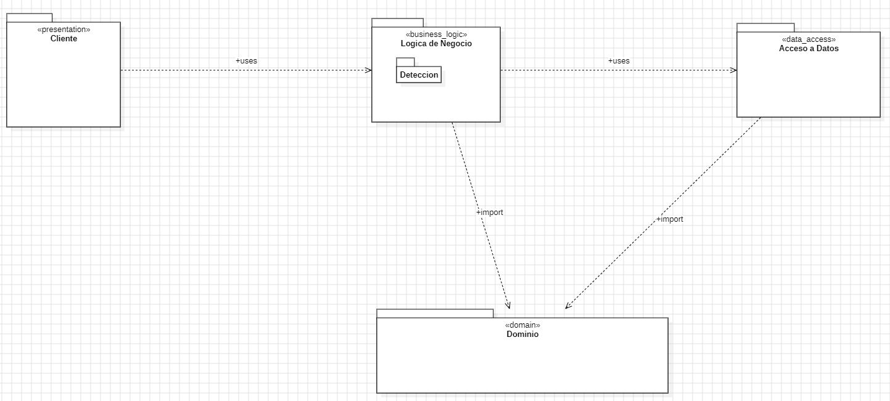

## Diagrama de Paquetes

El sistema adopta una **arquitectura Cliente/Servidor en 3 capas horizontales** (`Cliente`, `Logica de Negocio` y `Acceso a Datos`), apoyada en un paquete base transversal de nivel inferior (`Dominio`). Esta distribución busca alta cohesión, bajo acoplamiento y **cero dependencias cíclicas**, garantizando que todas las relaciones fluyan en un único sentido.

### Organización y responsabilidades

* **`Cliente` (`<<presentation>>`)**: Interfaz web que utiliza el gestor en el navegador. Agrupa la visualización gráfica (**RF5**) y el panel de incidencias y suscripciones (**RF4.1, RF4.2**). Depende únicamente de `Logica de Negocio` (`+uses`) mediante llamadas HTTP/REST (**RD2**).
* **`Logica de Negocio` (`<<business_logic>>`)**: Núcleo del servidor que coordina las peticiones, solicita datos a la capa de acceso, prepara las gráficas (**RF5**) y gestiona suscripciones (**RF4**). Incluye el subpaquete interno **`Deteccion`** con los detectores de incidencias y el modelo de Machine Learning (**RF3, RD8**). Usa (`+uses`) `Acceso a Datos` e importa (`+import`) el `Dominio`.
* **`Acceso a Datos` (`<<data_access>>`)**: Aísla la lectura del fichero CSV (**RF1, RD3**), normaliza la hora, el estado y el voltaje (**RD4–RD6**) y persiste las lecturas e incidencias. Importa (`+import`) las clases del `Dominio` sin depender nunca de la lógica de negocio.
* **`Dominio` (`<<domain>>`)**: Capa base con las entidades del problema (`Via`, `Dispositivo`, `Lectura`, `Incidencia`, `Usuario`, `Gestor`, **RF2**). No depende de ningún otro paquete, permitiendo que la lógica y el acceso a datos compartan modelo sin acoplarse entre sí.