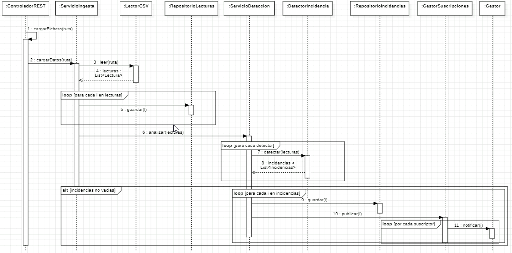

## Diagrama de Secuencia: Ingesta, Detección y Notificación

Este diagrama modela el comportamiento dinámico del flujo principal del sistema: la carga del fichero de lecturas, la detección inteligente de incidencias y la notificación automática a los gestores suscritos. Se ha seleccionado este escenario por concentrar la lógica de negocio crítica y los tres patrones de diseño aplicados.

### Fases del flujo de ejecución

El proceso comienza cuando el actor **`Usuario`** invoca `1: cargarFichero(ruta)` sobre `ControladorREST`:

1. **Carga de datos (mensajes 2 a 6)**: `ControladorREST` delega la petición en `ServicioIngesta` (`cargarDatos`), que utiliza `:LectorCSV` (a través de la abstracción `LectorDatos`, **patrón Adapter**) para parsear el fichero. Posteriormente, mediante un bloque `loop [para cada l en lecturas]`, persiste cada registro en `RepositorioLecturas` y devuelve la lista completa al controlador.
2. **Detección de incidencias (mensajes 7 a 11)**: El controlador envía las lecturas a `ServicioDeteccion` (`analizar`). Mediante un bloque `loop [por cada detector]`, delega el análisis en la interfaz `:DetectorIncidencia` (**patrón Strategy**), que se apoya en `:ModeloML` (`predecir`) para identificar anomalías y retornar las incidencias detectadas.
3. **Publicación y aviso (mensajes 12 a 14)**: Si se detectan incidencias (`opt [hay incidencias]`), se recorren en un `loop [para cada i en incidencias]` y se publican en `GestorSuscripciones`. Este almacena cada incidencia en `RepositorioIncidencias` (`guardar`) y ejecuta un `loop [por cada suscriptor]` invocando `notificar(i)` sobre cada `:Gestor` suscrito a esa categoría (**patrón Observer**).
4. **Respuesta (mensaje 15)**: Al finalizar el proceso, `ServicioDeteccion` retorna `incidencias: List<Incidencia>` a `ControladorREST` fuera del bloque `opt`, garantizando respuesta tanto si existen anomalías como si la lista está vacía.